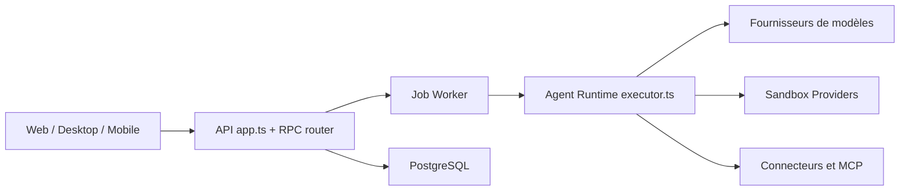

# elie222/rakazo

> Open source, self-hosted platform of persistent AI agents, with memory, routines and isolated computers.

## The problem
AI assistants forget everything between two sessions and do not act without supervision. The goal is durable AI teammates on your own infrastructure.

## What it actually does
"Bots" have their own conversations, memory, routines and history, and can delegate to other bots. They have a browser, terminal, files and graphical desktop in "computers" running on Docker, E2B, Daytona, CreateOS, Boat or Railway. Integrations through Composio, Pipedream, MCP, OpenAPI. Web, Electron and mobile clients; models via Pi.

## How it is wired


## Trying it
```bash
mkdir -p rakazo && cd rakazo &&
curl -fsSLO https://raw.githubusercontent.com/elie222/rakazo/main/infra/compose/install-images.sh &&
bash install-images.sh
```

## Cost and gotchas
Docker, curl and OpenSSL required; model keys or OpenRouter at your expense, and voice or remote sandbox keys optional. Remote sandboxes are billed by usage. README: "beta".

## What it is not
Not an agent development framework but a complete application. Treg is billed by usage and requires a written agreement for hosted resale.

## Alternatives
- OpenClaw: alternative cited, compared in the README.
- Hermes Agent: same.

## For you
Keep an eye on it: complete stack for persistent agents, interesting for MLOps monitoring, but a young project (created in August 2026) and in beta, to be tested in a sandbox before any real data.
