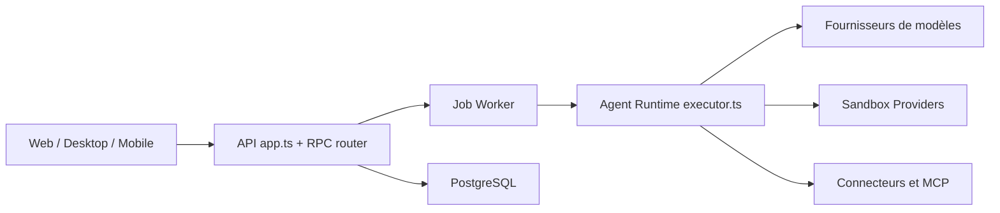

# elie222/rakazo

> Plateforme open source auto-hébergée d'agents IA persistants, avec mémoire, routines et ordinateurs isolés.

## Le problème
Les assistants IA oublient tout entre deux sessions et n'agissent pas sans surveillance. On veut des coéquipiers IA durables sur sa propre infra.

## Ce que ça fait vraiment
Des « bots » ont leurs conversations, mémoire, routines et historique, et peuvent déléguer à d'autres bots. Ils disposent de navigateur, terminal, fichiers et bureau graphique dans des « computers » Docker, E2B, Daytona, CreateOS, Boat ou Railway. Intégrations via Composio, Pipedream, MCP, OpenAPI. Clients web, Electron et mobile ; modèles via Pi.

## Comment c'est branché


## Essayer
```bash
mkdir -p rakazo && cd rakazo &&
curl -fsSLO https://raw.githubusercontent.com/elie222/rakazo/main/infra/compose/install-images.sh &&
bash install-images.sh
```

## Coût et pièges
Docker, curl et OpenSSL requis ; clés de modèle ou OpenRouter à ta charge, et clés de voix ou de sandbox distantes en option. Sandboxes distantes facturées à l'usage. README : « beta ».

## Ce que ce n'est pas
Pas un framework de développement d'agents mais une application complète. Treg est facturé à l'usage et exige un accord écrit pour une revente hébergée.

## Alternatives
- OpenClaw : alternative citée, comparée dans le README.
- Hermes Agent : idem.

## Pour toi
À surveiller : stack complète pour agents persistants, intéressante en veille MLOps, mais projet jeune (créé en août 2026) et beta, à tester en bac à sable avant toute donnée réelle.

