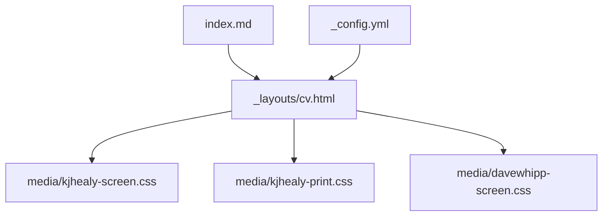

# elipapa/markdown-cv

> A CV written in Markdown, rendered to HTML and PDF by Jekyll and CSS.

## The problem
Maintaining a CV in a word processor is cumbersome to version and format.

## What it actually does
You edit index.md; Jekyll assembles it with the _layouts/cv.html template; the style chosen in _config.yml (kjhealy or davewhipp) applies the screen and print CSS stylesheets. Published via GitHub Pages or built locally, then printed to PDF from the browser.

## How it is wired


## Trying it
```bash
gem install bundler jekyll
jekyll serve
```
The local rendering is served at http://localhost:4000.

## Cost and gotchas
Free. Last push in June 2024. The local route requires Ruby (gem) and Jekyll; PDF export goes through the browser's print function.

## What it is not
Not an automated PDF generator nor an editor: only two styles, anything else is CSS you write yourself.

## Alternatives
No alternative named in the README, apart from the kjh-vita template it is inspired by.

## For you
Worth watching: useful if you want a CV versioned in Git and published on GitHub Pages, unrelated to your core work.
