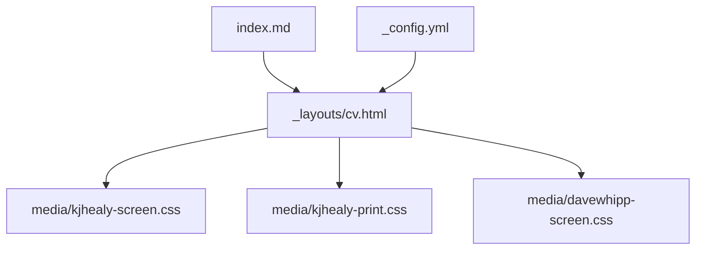

# elipapa/markdown-cv

> Un CV écrit en Markdown, rendu en HTML et en PDF par Jekyll et du CSS.

## Le problème
Maintenir un CV dans un traitement de texte est lourd à versionner et à mettre en forme.

## Ce que ça fait vraiment
Tu édites index.md ; Jekyll l'assemble avec le gabarit _layouts/cv.html ; le style choisi dans _config.yml (kjhealy ou davewhipp) applique les feuilles CSS d'écran et d'impression. Publication par GitHub Pages ou construction locale, puis impression en PDF depuis le navigateur.

## Comment c'est branché


## Essayer
```bash
gem install bundler jekyll
jekyll serve
```
Le rendu local est servi sur http://localhost:4000.

## Coût et pièges
Gratuit. Dernier push en juin 2024. Pour la voie locale il faut Ruby (gem) et Jekyll ; l'export PDF passe par l'impression du navigateur.

## Ce que ce n'est pas
Pas un générateur de PDF automatisé ni un éditeur : deux styles seulement, le reste en CSS à écrire.

## Alternatives
Aucune alternative nommée dans le README, hormis le modèle kjh-vita dont il s'inspire.

## Pour toi
Surveiller : utile si tu veux un CV versionné dans Git et publié sur GitHub Pages, sans rapport avec ton cœur de métier.

