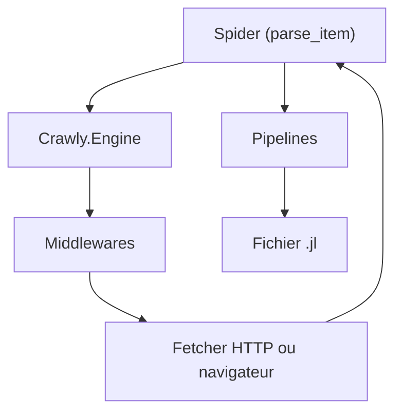

# elixir-crawly/crawly

> Elixir framework for crawling sites and extracting structured data.

## The problem
Writing scrapers means reinventing request queues, duplicate filters and outputs.

## What it actually does
You write a "spider" module with `parse_item`, and Crawly handles the request queue, the middlewares (domain, duplicates, user-agent) and the pipelines (validation, JSON, file writing). A local management interface on port 4001 lets you start and stop spiders. Browser rendering is configurable, and a standalone container mode accepts spiders in YAML.

## How it is wired


Simplified diagram based on the sheet, no diagram provided.

## Trying it
```bash
mix new quickstart --sup
mix deps.get
mix crawly.gen.spider --filepath ./lib/crawly_example/books_to_scrape.ex --spidername BooksToScrape
iex -S mix run -e "Crawly.Engine.start_spider(BooksToScrape)"
```

## Cost and gotchas
Free; Elixir 1.14 minimum. Last push in July 2025, so upkeep needs checking.

## What it is not
Not a no-code tool nor a hosted scraping service. It requires mastering Elixir, which is rare in a data team.

## Alternatives
No alternative named in the README.

## For you
Ignore unless you are already on Elixir: a Python scraping stack covers data needs better, and the repo is barely active.
