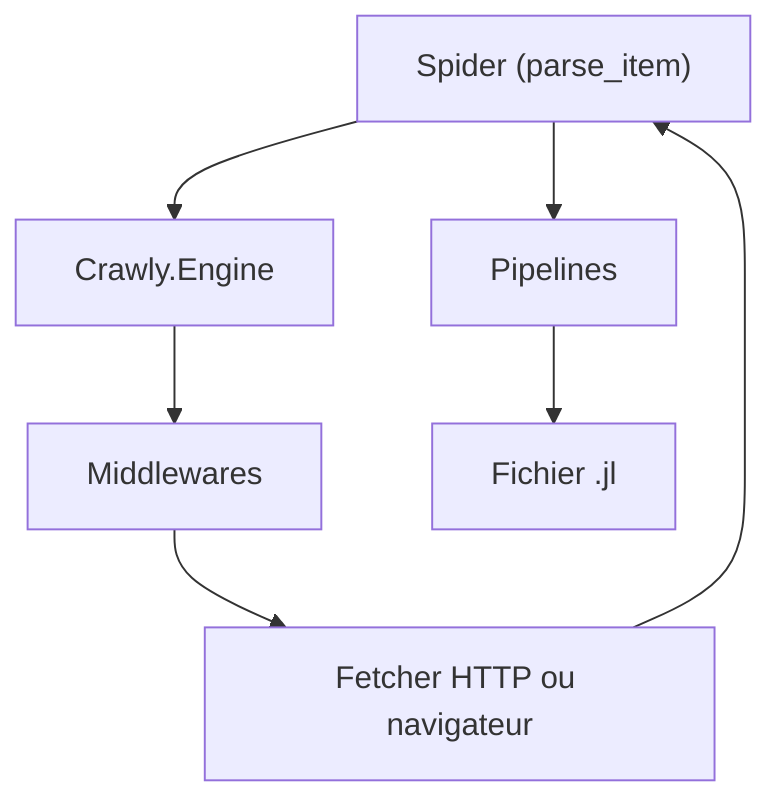

# elixir-crawly/crawly

> Framework Elixir pour parcourir des sites et en extraire des données structurées.

## Le problème
Écrire des robots d'extraction demande de réinventer files de requêtes, filtres de doublons et sorties.

## Ce que ça fait vraiment
Tu écris un module « spider » avec `parse_item`, et Crawly gère la file de requêtes, les middlewares (domaine, doublons, user-agent) et les pipelines (validation, JSON, écriture fichier). Une interface de gestion locale sur le port 4001 permet de lancer et arrêter les spiders. Un rendu navigateur est configurable, et un mode autonome en conteneur accepte des spiders en YAML.

## Comment c'est branché


Schéma simplifié d'après la fiche, sans diagramme fourni.

## Essayer
```bash
mix new quickstart --sup
mix deps.get
mix crawly.gen.spider --filepath ./lib/crawly_example/books_to_scrape.ex --spidername BooksToScrape
iex -S mix run -e "Crawly.Engine.start_spider(BooksToScrape)"
```

## Coût et pièges
Gratuit ; Elixir 1.14 minimum. Dernier push en juillet 2025, donc suivi à vérifier.

## Ce que ce n'est pas
Pas un outil sans code ni un service de scraping hébergé. Il demande de maîtriser Elixir, ce qui est rare dans une équipe data.

## Alternatives
Aucune alternative nommée dans le README.

## Pour toi
À ignorer sauf si tu es déjà sur Elixir : une pile de scraping Python couvre mieux les besoins data, et le dépôt est peu actif.

