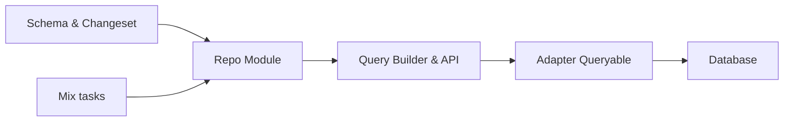

# elixir-ecto/ecto

> Elixir toolkit for data mapping and language-integrated queries.

## The problem
Interacting with a database from Elixir without writing raw SQL and while validating the data.

## What it actually does
Schemas (`Ecto.Schema`), changesets (validation, conversion), composable queries, `Repo` and adapters: PostgreSQL, MySQL, MSSQL, SQLite3, ClickHouse, ETS. It can also map data from outside a database into Elixir structures. Mix tasks (`ecto.create`, `ecto.drop`).

## How it is wired


## Trying it
```bash
mix deps.get
mix test
```
For PostgreSQL, add `{:ecto_sql, "~> 3.0"}` and `{:postgrex, ">= 0.0.0"}` to `mix.exs`.

## Cost and gotchas
Free; you need an adapter and a DBMS. Integration tests require the `ecto_sql` repository alongside.

## What it is not
Not a classic ORM; not usable outside Elixir.

## Alternatives
No alternative named in the README.

## For you
Ignore: useful only if you develop in Elixir.
