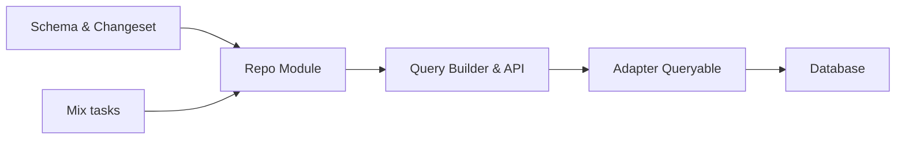

# elixir-ecto/ecto

> Boîte à outils Elixir pour le mappage de données et les requêtes intégrées au langage.

## Le problème
Interagir avec une base depuis Elixir sans écrire du SQL brut et en validant les données.

## Ce que ça fait vraiment
Schémas (`Ecto.Schema`), changesets (validation, conversion), requêtes composables, `Repo` et adaptateurs : PostgreSQL, MySQL, MSSQL, SQLite3, ClickHouse, ETS. Peut aussi mapper des données hors base vers des structures Elixir. Tâches Mix (`ecto.create`, `ecto.drop`).

## Comment c'est branché


## Essayer
```bash
mix deps.get
mix test
```
Pour PostgreSQL, ajouter `{:ecto_sql, "~> 3.0"}` et `{:postgrex, ">= 0.0.0"}` dans `mix.exs`.

## Coût et pièges
Gratuit ; il faut un adaptateur et un SGBD. Les tests d'intégration demandent le dépôt `ecto_sql` à côté.

## Ce que ce n'est pas
Pas un ORM classique ; pas utilisable hors Elixir.

## Alternatives
Aucune alternative nommée dans le README.

## Pour toi
À ignorer : utile seulement si tu développes en Elixir.

