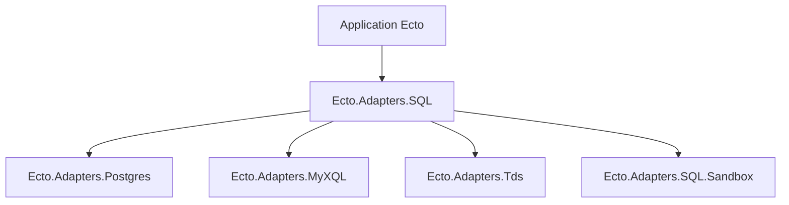

# elixir-ecto/ecto_sql

> Elixir building blocks for writing Ecto SQL adapters, with Postgres, MySQL and MSSQL by default.

## The problem
Ecto needs a common layer to talk to SQL databases, handle migrations and isolate tests.

## What it actually does
Provides the `Ecto.Adapters.SQL` module, the Postgres, MyXQL and Tds adapters, a test sandbox that runs each test in a transaction, and migrations through Mix tasks.

## How it is wired
Simplified diagram based on the sheet, no diagram provided.



## Trying it
```bash
git clone https://github.com/elixir-ecto/ecto_sql.git
cd ecto_sql
mix deps.get
mix test
```

## Cost and gotchas
Elixir and Mix required (not in the prerequisites list). Integration tests need a local database, for example MSSQL in Docker. The README is mostly a contribution guide.

## What it is not
Not a standalone ORM: it complements Ecto, whose repository you must read to get started.

## Alternatives
None cited in the README.

## For you
Ignore: an Elixir library, outside the tools of a data / AI / MLOps profile.
