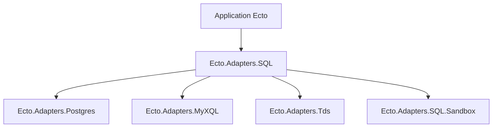

# elixir-ecto/ecto_sql

> Briques Elixir pour écrire des adaptateurs SQL d'Ecto, avec Postgres, MySQL et MSSQL par défaut.

## Le problème
Ecto a besoin d'une couche commune pour parler aux bases SQL, gérer les migrations et isoler les tests.

## Ce que ça fait vraiment
Fournit le module `Ecto.Adapters.SQL`, les adaptateurs Postgres, MyXQL et Tds, un bac à sable de tests qui exécute chaque test dans une transaction, et les migrations par tâches Mix.

## Comment c'est branché
Schéma simplifié d'après la fiche, sans diagramme fourni.



## Essayer
```bash
git clone https://github.com/elixir-ecto/ecto_sql.git
cd ecto_sql
mix deps.get
mix test
```

## Coût et pièges
Elixir et Mix nécessaires (hors liste des prérequis). Les tests d'intégration demandent une base locale, par exemple MSSQL en Docker. Le README est surtout un guide de contribution.

## Ce que ce n'est pas
Pas un ORM autonome : il complète Ecto, dont il faut lire le dépôt pour démarrer.

## Alternatives
Aucune citée dans le README.

## Pour toi
Ignorer : bibliothèque Elixir, hors des outils d'un profil data / IA / MLOps.

