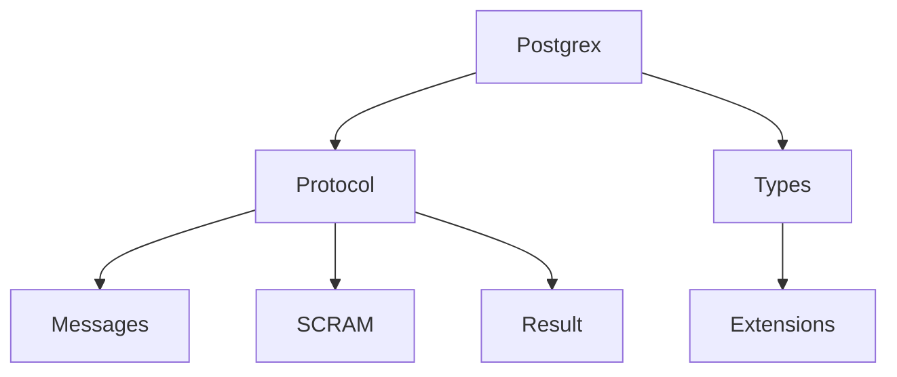

# elixir-ecto/postgrex

> PostgreSQL driver for Elixir, which speaks the binary protocol and handles types.

## The problem
An Elixir app needs to talk to PostgreSQL with correct type encoding.

## What it actually does
It opens connections through DBConnection and talks over the binary protocol (not text). It encodes and decodes PostgreSQL types (arrays, ranges, hstore, JSON, uuid, tsvector), accepts custom type extensions, and handles transactions, prepared statements, streams, LISTEN/NOTIFY notifications, replication and SCRAM authentication.

## How it is wired


## Trying it
```bash
iex> {:ok, pid} = Postgrex.start_link(hostname: "localhost", username: "postgres", password: "postgres", database: "postgres")
iex> Postgrex.query!(pid, "SELECT user_id, text FROM comments", [])
```

## Cost and gotchas
Free. With PgBouncer older than 1.21.0, named prepared statements fail: use `prepare: :unnamed`. OID types need an explicit cast.

## What it is not
Not an ORM (it is the driver underneath Ecto, not described here). No automatic conversion between text and date types. No license according to the catalog.

## Alternatives
No alternative named in the README.

## For you
Ignore: an Elixir-specific driver, of no interest if you work in Python; only look at it if you are building an Elixir backend.
