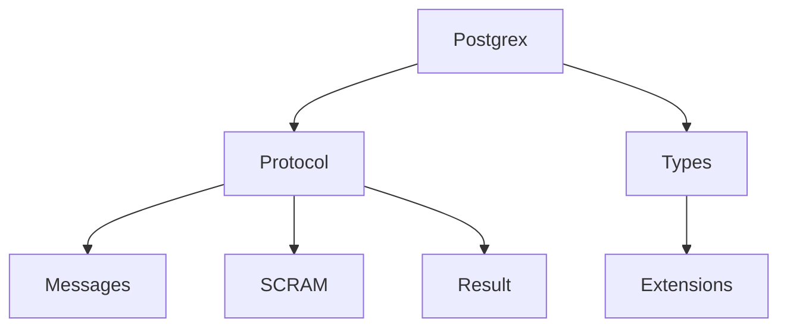

# elixir-ecto/postgrex

> Pilote PostgreSQL pour Elixir, qui parle le protocole binaire et gère les types.

## Le problème
Une appli Elixir a besoin de parler à PostgreSQL avec un encodage correct des types.

## Ce que ça fait vraiment
Il ouvre des connexions via DBConnection et dialogue en protocole binaire (pas texte). Il encode et décode les types PostgreSQL (tableaux, plages, hstore, JSON, uuid, tsvector), accepte des extensions de types personnalisées, et gère transactions, requêtes préparées, flux, notifications LISTEN/NOTIFY, réplication et authentification SCRAM.

## Comment c'est branché


## Essayer
```bash
iex> {:ok, pid} = Postgrex.start_link(hostname: "localhost", username: "postgres", password: "postgres", database: "postgres")
iex> Postgrex.query!(pid, "SELECT user_id, text FROM comments", [])
```

## Coût et pièges
Gratuit. Avec PgBouncer antérieur à 1.21.0, les requêtes préparées nommées échouent : utiliser `prepare: :unnamed`. Les types OID demandent un cast explicite.

## Ce que ce n'est pas
Pas un ORM (c'est le pilote sous-jacent d'Ecto, non décrit ici). Pas de conversion de types automatique entre texte et date. Licence absente selon le catalogue.

## Alternatives
Aucune alternative nommée dans le README.

## Pour toi
Ignorer : pilote spécifique à Elixir, sans intérêt si tu travailles en Python ; ne regarde que si tu montes un backend Elixir.

