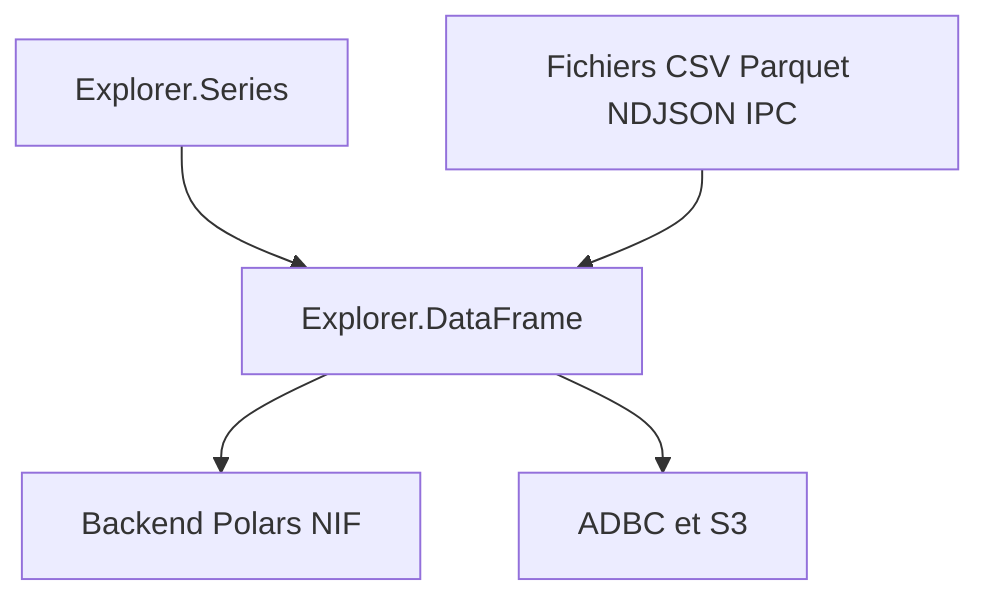

# elixir-explorer/explorer

> Series and dataframes for Elixir, backed by Polars, to explore data in Livebook or an app.

## The problem
Elixir has no dataframe API comparable to pandas or dplyr for handling tables efficiently.

## What it actually does
It provides typed series and dplyr-inspired dataframes, with Polars through Rust NIFs by default. It reads and writes CSV, Parquet, NDJSON and Arrow IPC, connects to databases via ADBC and to S3. Functions always return new structures without mutating existing ones. Native code is precompiled for common architectures.

## How it is wired
Simplified diagram based on the fiche, no diagram provided.



## Trying it
```elixir
Mix.install([
  {:explorer, "~> 0.13.0"}
])
```
```elixir
require Explorer.DataFrame, as: DF
DF.filter(mountains, elevation > mean(elevation))
```

## Cost and gotchas
Free. The precompiled native binary only applies to Hex versions; otherwise use `EXPLORER_BUILD=1` and `:rustler`. NDJSON and S3 are disabled on RISCV. "Illegal instruction" error: enable `use_legacy_artifacts`.

## What it is not
Not the fastest dataframe library, as the README itself says. Not a distributed engine: remote or Spark backends are announced as upcoming.

## Alternatives
Dux, for a dataframe API backed by DuckDB rather than Polars.

## For you
Worth watching: relevant only if your team does data work in Elixir; otherwise Polars or pandas in Python remain simpler.
