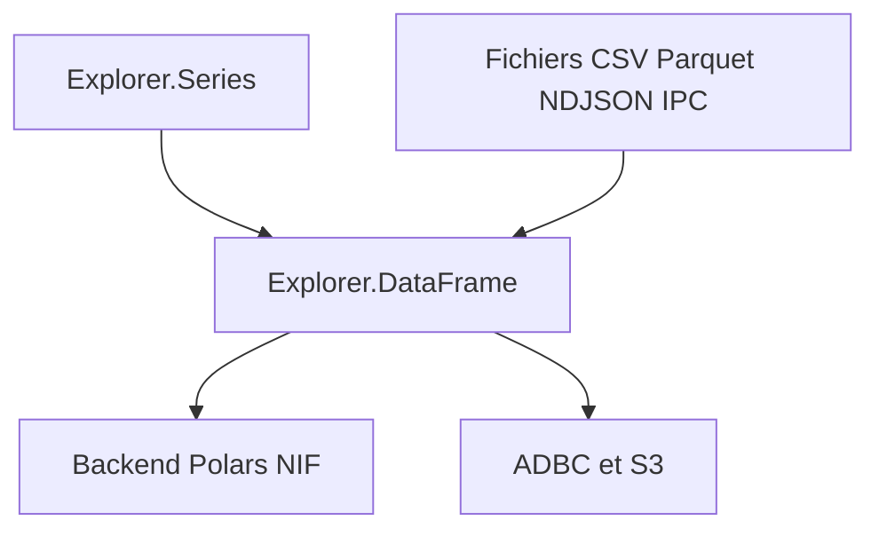

# elixir-explorer/explorer

> Séries et dataframes pour Elixir, adossés à Polars, pour explorer des données dans Livebook ou une appli.

## Le problème
Elixir n'a pas d'API dataframe comparable à pandas ou dplyr pour manipuler des tables de façon efficace.

## Ce que ça fait vraiment
Il fournit des séries typées et des dataframes inspirés de dplyr, avec Polars via des NIF Rust par défaut. Il lit et écrit CSV, Parquet, NDJSON et Arrow IPC, se connecte à des bases via ADBC et à S3. Les fonctions renvoient toujours de nouvelles structures sans muter l'existant. Le code natif est précompilé pour les architectures courantes.

## Comment c'est branché
Schéma simplifié d'après la fiche, sans diagramme fourni.



## Essayer
```elixir
Mix.install([
  {:explorer, "~> 0.13.0"}
])
```
```elixir
require Explorer.DataFrame, as: DF
DF.filter(mountains, elevation > mean(elevation))
```

## Coût et pièges
Gratuit. Le binaire natif précompilé ne vaut que pour les versions Hex ; sinon `EXPLORER_BUILD=1` et `:rustler`. NDJSON et S3 sont désactivés sur RISCV. Erreur « Illegal instruction » : activer `use_legacy_artifacts`.

## Ce que ce n'est pas
Pas la bibliothèque dataframe la plus rapide, le README le dit lui-même. Ce n'est pas un moteur distribué : les backends distants ou Spark sont annoncés comme à venir.

## Alternatives
Dux, pour une API dataframe adossée à DuckDB plutôt qu'à Polars.

## Pour toi
À surveiller : pertinent seulement si ton équipe fait de la donnée en Elixir ; sinon Polars ou pandas en Python restent plus simples.

