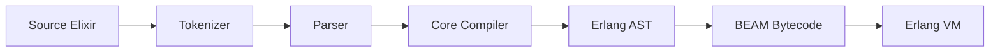

# elixir-lang/elixir

> Functional language on the Erlang virtual machine, for concurrent and maintainable applications.

## The problem
Building scalable, fault-tolerant services without reinventing concurrency.

## What it actually does
The repository README is mostly a contribution guide: bug reporting, proposals via the mailing list, building from source with `make` (Erlang required). From the code architecture: tokenizer, parser, compiler to the Erlang AST then BEAM bytecode, standard library, plus IEx, Mix, ExUnit, Logger and EEx.

## How it is wired


## Trying it
```bash
git clone https://github.com/elixir-lang/elixir.git
cd elixir
make
```

## Cost and gotchas
Free; building from source requires Erlang. Other installation methods are described on the website, not in the README.

## What it is not
Not a language tutorial: the README points to the website. The tracker closes support requests and non-actionable issues.

## Alternatives
No alternative named in the README.

## For you
Little connection to mainstream data/ML (Python ecosystem); worth watching if you build highly concurrent real-time pipelines.
