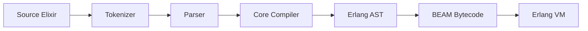

# elixir-lang/elixir

> Langage fonctionnel sur la machine virtuelle Erlang, pour applications concurrentes et maintenables.

## Le problème
Construire des services scalables et tolérants aux pannes sans réinventer la concurrence.

## Ce que ça fait vraiment
Le README du dépôt est surtout un guide de contribution : signalement de bugs, propositions via la liste de diffusion, compilation depuis les sources avec `make` (Erlang requis). D'après l'architecture du code : tokenizer, parser, compilateur vers l'AST Erlang puis le bytecode BEAM, bibliothèque standard, plus IEx, Mix, ExUnit, Logger et EEx.

## Comment c'est branché


## Essayer
```bash
git clone https://github.com/elixir-lang/elixir.git
cd elixir
make
```

## Coût et pièges
Gratuit ; compiler depuis les sources exige Erlang. Les autres modes d'installation sont décrits sur le site, pas dans le README.

## Ce que ce n'est pas
Pas un tutoriel du langage : le README renvoie au site. Le tracker ferme les demandes de support et les issues non actionnables.

## Alternatives
Aucune alternative nommée dans le README.

## Pour toi
Peu de lien avec le data/ML mainstream (écosystème Python) ; à surveiller si tu bâtis des pipelines temps réel très concurrents.

