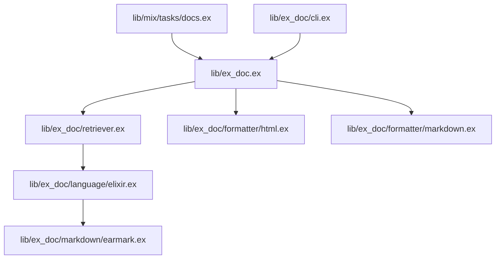

# elixir-lang/ex_doc

> HTML, EPUB and Markdown documentation generator for Elixir and Erlang projects.

## The problem
You need to turn a project's docstrings and guides into a navigable documentation site, with search and cross-references.

## What it actually does
The `mix docs` task or the CLI configures ExDoc, which calls the retriever to read the modules' documentation. Docstrings go to an AST via Earmark, then the html.ex, epub.ex and markdown.ex formatters produce the output (including llms.txt). Search, night mode, links to sources, Markdown pages, cheatsheets and Livebook.

## How it is wired


## Trying it
```bash
mix deps.get
mix docs
mix escript.install hex ex_doc
```

## Cost and gotchas
Free. Requires Elixir 1.15+; on Debian, `erlang-dev` may be missing. License present but not identified by GitHub.

## What it is not
Only documents the Erlang/Elixir ecosystem; it is not a multi-language generator.

## Alternatives
rebar3_ex_doc is cited for Erlang projects.

## For you
Ignore: only makes sense for Elixir or Erlang projects, not for Python data work.
