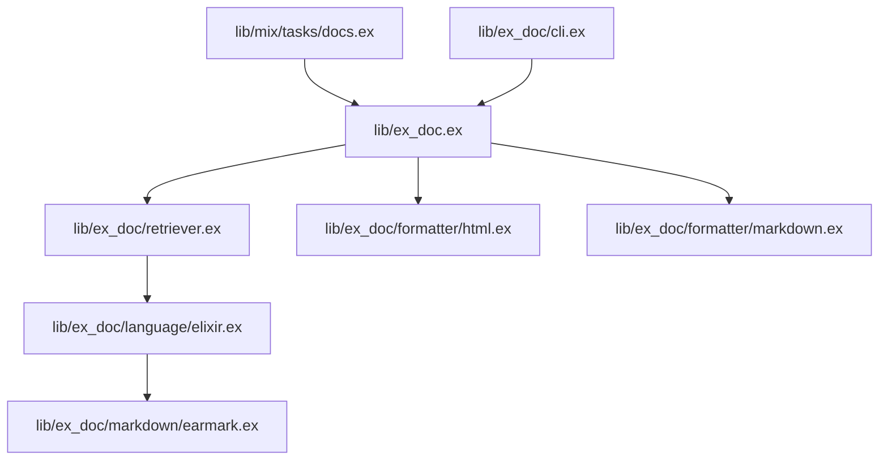

# elixir-lang/ex_doc

> Générateur de documentation HTML, EPUB et Markdown pour projets Elixir et Erlang.

## Le problème
Il faut transformer les docstrings et les guides d'un projet en site de documentation navigable, avec recherche et liens croisés.

## Ce que ça fait vraiment
La tâche `mix docs` ou la CLI configure ExDoc, qui appelle le retriever pour lire la documentation des modules. Les docstrings passent en AST via Earmark, puis les formateurs html.ex, epub.ex et markdown.ex produisent la sortie (y compris llms.txt). Recherche, mode nuit, liens vers les sources, pages Markdown, cheatsheets et Livebook.

## Comment c'est branché


## Essayer
```bash
mix deps.get
mix docs
mix escript.install hex ex_doc
```

## Coût et pièges
Gratuit. Exige Elixir 1.15+ ; sur Debian, `erlang-dev` peut manquer. Licence présente mais non identifiée par GitHub.

## Ce que ce n'est pas
Ne documente que l'écosystème Erlang/Elixir ; ce n'est pas un générateur multi-langages.

## Alternatives
rebar3_ex_doc est cité pour les projets Erlang.

## Pour toi
À ignorer : n'a de sens que pour des projets Elixir ou Erlang, pas pour du Python data.

