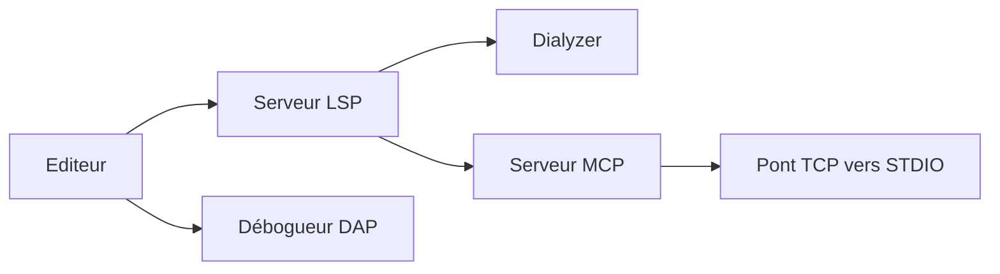

# elixir-lsp/elixir-ls

> Language server and debug adapter for Elixir, with a built-in MCP server for language models.

## The problem
An editor needs completion, diagnostics and a debugger for Elixir.

## What it actually does
- LSP: definitions, completion, formatting, references, symbols, incremental Dialyzer analysis.
- DAP debugger: conditional, function and log breakpoints, attach to a remote node.
- MCP server (disabled by default, `elixirLS.mcpEnabled`): find a definition, read docs, types, dependencies.
- Community fork: the original repository JakeBecker/elixir-ls is abandoned.
- First Dialyzer run: more than 10 minutes of CPU.

## How it is wired


## Trying it
```bash
mix deps.get
MIX_ENV=prod mix compile
MIX_ENV=prod mix elixir_ls.release2 -o <release_dir>
```

## Cost and gotchas
Free. Remote debugging interprets modules on all connected nodes: be careful in production. Telemetry (usage, performance, errors) is sent to the client.

## What it is not
Not a compiler. The debugger does not handle Phoenix live reload or interpreted Cowboy and Ecto well.

## Alternatives
Expert, the official Elixir server (mentioned in the README of its own repositories; not cited here).

## For you
Worth watching only for the MCP server given to an agent working on Elixir code; otherwise off-topic for data / AI.
