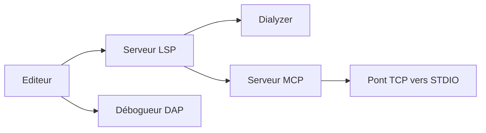

# elixir-lsp/elixir-ls

> Serveur de langage et adaptateur de débogage pour Elixir, avec un serveur MCP intégré pour les modèles de langage.

## Le problème
Un éditeur a besoin de complétion, de diagnostics et d'un débogueur pour Elixir.

## Ce que ça fait vraiment
- LSP : définitions, complétion, formatage, références, symboles, analyse Dialyzer incrémentale.
- Débogueur DAP : points d'arrêt conditionnels, de fonction, journaux, attache à un nœud distant.
- Serveur MCP (désactivé par défaut, `elixirLS.mcpEnabled`) : trouver une définition, lire la doc, les types, les dépendances.
- Fork communautaire : le dépôt d'origine JakeBecker/elixir-ls est abandonné.
- Premier Dialyzer : plus de 10 minutes de CPU.

## Comment c'est branché


## Essayer
```bash
mix deps.get
MIX_ENV=prod mix compile
MIX_ENV=prod mix elixir_ls.release2 -o <release_dir>
```

## Coût et pièges
Gratuit. Le débogage distant interprète les modules sur tous les nœuds connectés : prudence en production. La télémétrie (usage, performances, erreurs) est envoyée au client.

## Ce que ce n'est pas
Pas un compilateur. Le débogueur ne gère pas bien Phoenix live reload ni Cowboy et Ecto interprétés.

## Alternatives
Expert, serveur officiel Elixir (mentionné dans le README de ses propres dépôts ; ici non cité).

## Pour toi
À surveiller seulement pour le serveur MCP donné à un agent sur du code Elixir ; sinon hors sujet pour data / IA.

