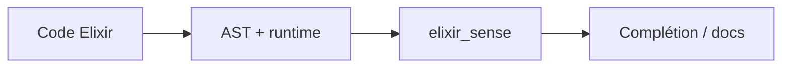

# elixir-lsp/elixir_sense

> Elixir API providing completion, documentation and go-to-definition through AST and runtime inspection.

## The problem
Elixir editing tools need reusable code-analysis building blocks.

## What it actually does
Introspection library (AST and runtime) for completion, docs, signatures, definitions, macro expansion. Reuses code from IEx and ExDoc. Serves as the foundation of Elixir LS (not specified in this README).

## How it is wired


## Trying it
```bash
mix deps.get
mix test
mix test --include requires_source
```

## Cost and gotchas
Free. Some tests require an Elixir source installation (asdf `ref:v1.12.3` or kiex).

## What it is not
Not a complete LSP server; a building block for making one.

## Alternatives
No alternative named in the README.

## For you
Ignore: useful only if you build tooling for the Elixir editor; nothing for data/AI.
