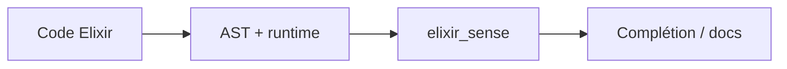

# elixir-lsp/elixir_sense

> API Elixir fournissant complétion, documentation et aller-à-la-définition par inspection AST et runtime.

## Le problème
Les outils d'édition Elixir ont besoin de briques d'analyse de code réutilisables.

## Ce que ça fait vraiment
Bibliothèque d'introspection (AST et runtime) pour complétion, doc, signatures, définitions, expansion de macros. Reprend du code d'IEx et d'ExDoc. Sert de socle à l'Elixir LS (non précisé dans ce README).

## Comment c'est branché


## Essayer
```bash
mix deps.get
mix test
mix test --include requires_source
```

## Coût et pièges
Gratuit. Certains tests exigent une installation de source d'Elixir (asdf `ref:v1.12.3` ou kiex).

## Ce que ce n'est pas
Pas un serveur LSP complet ; une brique pour en construire.

## Alternatives
Aucune alternative nommée dans le README.

## Pour toi
À ignorer : utile seulement si tu outilles l'éditeur Elixir ; rien pour data/IA.

