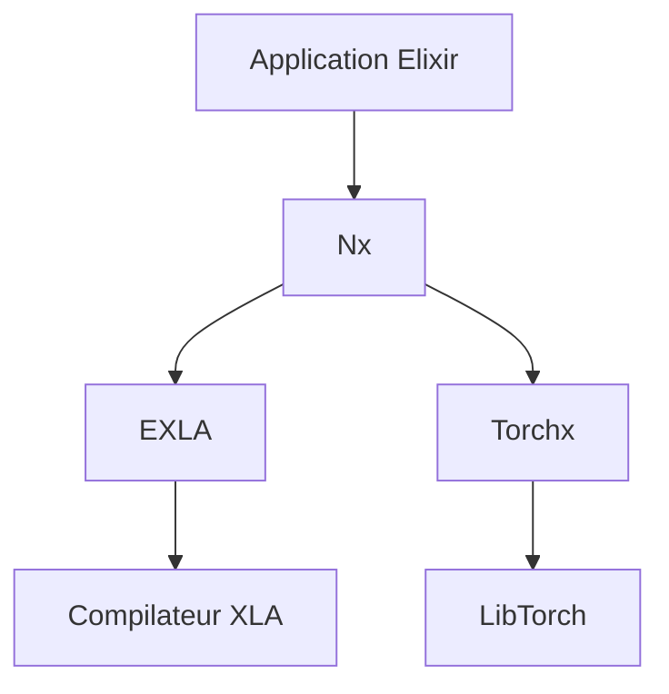

# elixir-nx/nx

> Elixir repository bundling Nx (tensors), EXLA (XLA compiler) and Torchx (LibTorch backend).

## The problem
Elixir has no native multidimensional numerical computing. Without tensors or an accelerated backend, machine learning is impractical there.

## What it actually does
The repository contains three projects: Nx (multidimensional arrays and numerical definitions), EXLA (a backend based on Google's XLA compiler) and Torchx (a LibTorch backend). Each has its own README, which is not provided here. Examples and benchmarks are in the EXLA project. The projects are eventually meant to be extracted into their own repositories.

## How it is wired
Simplified diagram based on the sheet, no diagram provided.



## Trying it
```bash
# Aucune commande documentée dans ce README : voir le README de chaque projet (Nx, EXLA, Torchx).
```

## Cost and gotchas
The README says nothing about cost or prerequisites. The announced extraction of the projects into other repositories may move links and names.

## What it is not
It is not a guide: the README merely lists the three projects. The license is not declared in the catalog; check it before any use.

## Alternatives
No alternative is named in the README.

## For you
Worth watching: a natural foundation for ML in Elixir, but the material provided is too thin and the license undeclared to conclude further.
