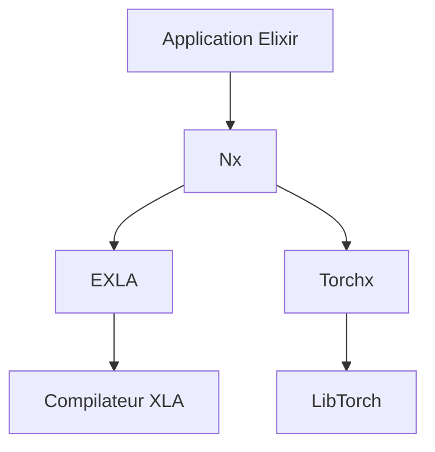

# elixir-nx/nx

> Dépôt Elixir regroupant Nx (tenseurs), EXLA (compilateur XLA) et Torchx (backend LibTorch).

## Le problème
Elixir n'a pas de calcul numérique multidimensionnel natif. Sans tenseurs ni backend accéléré, le machine learning y est impraticable.

## Ce que ça fait vraiment
Le dépôt contient trois projets : Nx (tableaux multidimensionnels et définitions numériques), EXLA (backend basé sur le compilateur XLA de Google) et Torchx (backend LibTorch). Chacun a son propre README, qui n'est pas fourni ici. Des exemples et benchmarks sont dans le projet EXLA. Les projets doivent à terme être extraits dans leurs propres dépôts.

## Comment c'est branché
Schéma simplifié d'après la fiche, sans diagramme fourni.



## Essayer
```bash
# Aucune commande documentée dans ce README : voir le README de chaque projet (Nx, EXLA, Torchx).
```

## Coût et pièges
Le README ne dit rien du coût ni des prérequis. L'extraction annoncée des projets vers d'autres dépôts peut déplacer les liens et les noms.

## Ce que ce n'est pas
Ce n'est pas un guide : le README ne fait que lister les trois projets. La licence n'est pas déclarée dans le catalogue, à vérifier avant tout usage.

## Alternatives
Aucune alternative n'est nommée dans le README.

## Pour toi
À surveiller : base naturelle pour du ML en Elixir, mais la matière fournie est trop mince et la licence non déclarée pour trancher plus loin.

