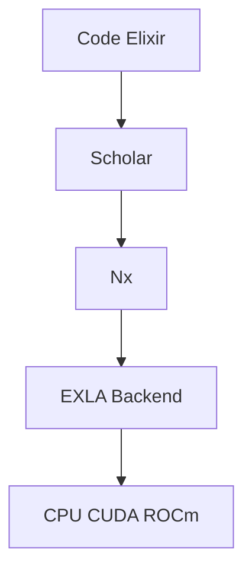

# elixir-nx/scholar

> Classical machine learning algorithms for Elixir, built on Nx: classification, regression, clustering.

## The problem
The Elixir ecosystem lacked a scikit-learn equivalent for traditional ML, outside deep learning.

## What it actually does
Implements classification, regression, clustering, dimensionality reduction, metrics and preprocessing on Nx. A compiler or backend such as EXLA is recommended (host, CUDA or ROCm). Many algorithms use loops that require JIT compilation to stay memory-efficient.

## How it is wired
Simplified diagram based on the sheet, no diagram supplied.



## Trying it
```elixir
def deps do
  [{:scholar, "~> 0.3.0"}, {:exla, ">= 0.0.0"}]
end

config :nx, :default_backend, EXLA.Backend
config :nx, :default_defn_options, [compiler: EXLA, client: :host]
```

## Cost and gotchas
Free. Without a default `defn` compiler, loops consume a lot of memory. Version 0.3.0: the API may still change. You need Elixir and the Mix tool, not Python.

## What it is not
It is not deep learning: the README points to Axon. It is not a port of scikit-learn.

## Alternatives
- Axon: for deep learning in the same ecosystem.

## For you
Watch: only interesting if you work in Elixir, otherwise scikit-learn remains the reference for classical ML.
