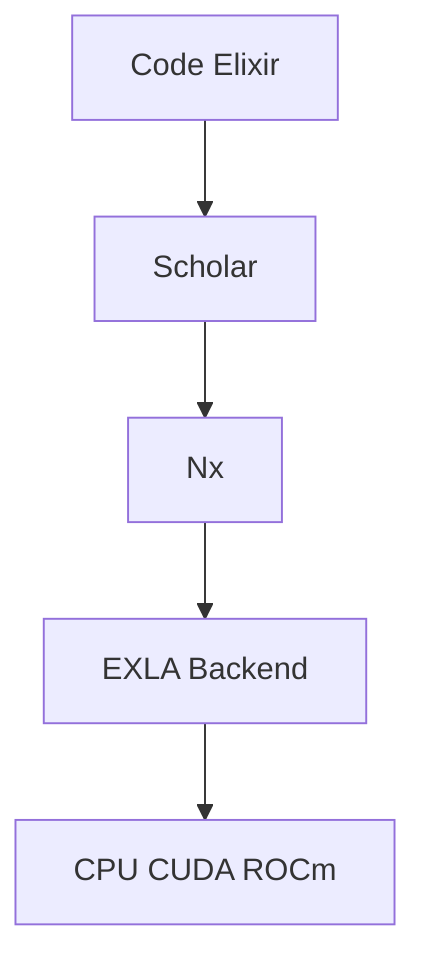

# elixir-nx/scholar

> Algorithmes d'apprentissage automatique classique pour Elixir, construits sur Nx : classification, régression, clustering.

## Le problème
L'écosystème Elixir manquait d'un équivalent de scikit-learn pour le ML traditionnel, hors deep learning.

## Ce que ça fait vraiment
Implémente classification, régression, clustering, réduction de dimension, métriques et prétraitement sur Nx. Un compilateur ou backend comme EXLA est recommandé (hôte, CUDA ou ROCm). Beaucoup d'algorithmes utilisent des boucles qui exigent la compilation JIT pour rester économes en mémoire.

## Comment c'est branché
Schéma simplifié d'après la fiche, sans diagramme fourni.



## Essayer
```elixir
def deps do
  [{:scholar, "~> 0.3.0"}, {:exla, ">= 0.0.0"}]
end

config :nx, :default_backend, EXLA.Backend
config :nx, :default_defn_options, [compiler: EXLA, client: :host]
```

## Coût et pièges
Gratuit. Sans compilateur `defn` par défaut, les boucles consomment beaucoup de mémoire. Version 0.3.0 : l'API peut encore bouger. Il faut Elixir et l'outil Mix, pas Python.

## Ce que ce n'est pas
Ce n'est pas du deep learning : le README renvoie vers Axon. Ce n'est pas un portage de scikit-learn.

## Alternatives
- Axon : pour le deep learning dans le même écosystème.

## Pour toi
À surveiller : intéressant seulement si tu travailles en Elixir, sinon scikit-learn reste la référence en ML classique.

