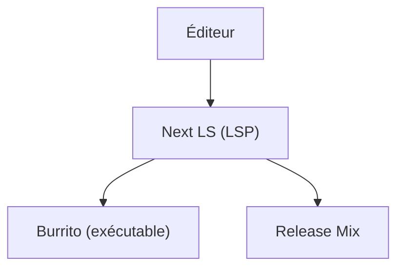

# elixir-tools/next-ls

> Language server for Elixir, now deprecated in favor of the official Expert server.

## The problem
Editors need a language server for autocompletion and navigation in Elixir.

## What it actually does
LSP server for Elixir, distributed as a single executable (Burrito) or as a regular Mix release. Development tasks go through `just`. The README announces the deprecation and the move to Expert; the repository is archived.

## How it is wired

Simplified diagram based on the sheet, no diagram provided.

## Trying it
```bash
just deps
just compile
just test
just build-local
```

## Cost and gotchas
Archived repository, last push in October 2025: no more fixes. You need `just` and the Elixir toolchain to build it.

## What it is not
Not the official language server and not maintained: the README redirects to Expert.

## Alternatives
- Expert: official language server for Elixir, cited by the README.

## For you
Archived and unrelated to data / AI: ignore, prefer Expert.
