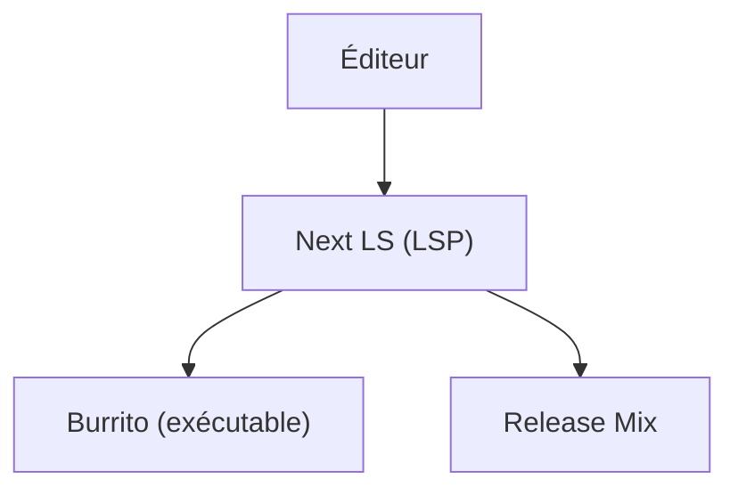

# elixir-tools/next-ls

> Serveur de langage pour Elixir, désormais déprécié au profit du serveur officiel Expert.

## Le problème
Les éditeurs ont besoin d'un serveur de langage pour l'autocomplétion et la navigation en Elixir.

## Ce que ça fait vraiment
Serveur LSP pour Elixir, distribué en exécutable unique (Burrito) ou en release Mix classique. Les tâches de développement passent par `just`. Le README signale la dépréciation et le passage à Expert ; le dépôt est archivé.

## Comment c'est branché

Schéma simplifié d'après la fiche, sans diagramme fourni.

## Essayer
```bash
just deps
just compile
just test
just build-local
```

## Coût et pièges
Dépôt archivé, dernier push en octobre 2025 : plus de correctifs. Il faut `just` et la chaîne Elixir pour compiler.

## Ce que ce n'est pas
Pas le serveur de langage officiel ni maintenu : le README redirige vers Expert.

## Alternatives
- Expert : serveur de langage officiel pour Elixir, cité par le README.

## Pour toi
Archivé et sans lien avec la data / IA : à ignorer, préférer Expert.

