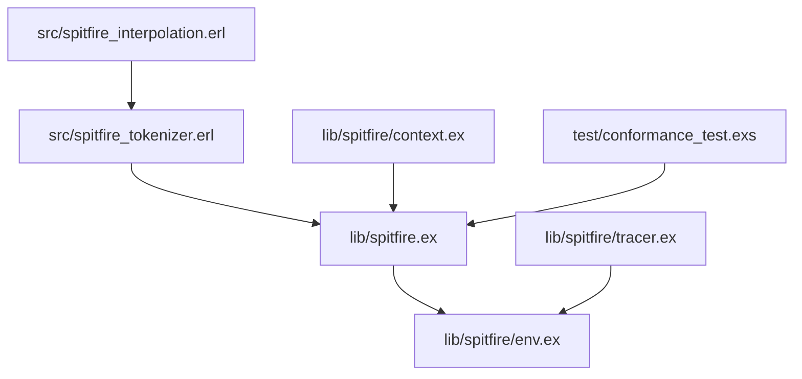

# elixir-tools/spitfire

> Error-tolerant Elixir parser, for editor tooling that analyzes incomplete code.

## The problem
Elixir's standard parser fails on unfinished code, which deprives editors of code intelligence while typing.

## What it actually does
Hand-written Pratt parser: it produces an AST compatible with Elixir's core and keeps going despite errors. It also exposes an API for querying the environment. Conformance tests compare it against the official parser.

## How it is wired


## Trying it
```bash
# Aucune commande documentée dans le README
```

## Cost and gotchas
Free, but reserved for Elixir ecosystems. No installation documented.

## What it is not
Not an end-user tool: a building block for Elixir editor tool authors. No usage documentation.

## Alternatives
- No alternative named in the README (it cites rustc and Prism as inspirations, not as competitors).

## For you
Ignore: only useful if you write editor tools for Elixir, unrelated to data / AI / MLOps.
