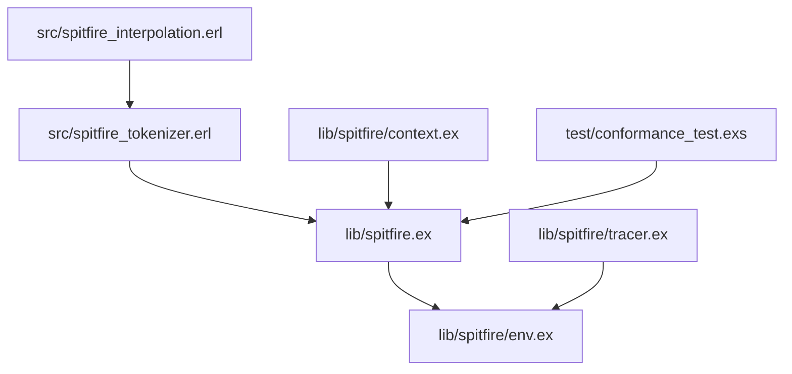

# elixir-tools/spitfire

> Parseur Elixir tolérant aux erreurs, pour les outils d'édition qui analysent du code incomplet.

## Le problème
Le parseur standard d'Elixir échoue sur du code inachevé, ce qui prive les éditeurs d'intelligence de code en cours de frappe.

## Ce que ça fait vraiment
Parseur de Pratt écrit à la main : il produit un AST compatible avec le cœur d'Elixir et continue malgré les erreurs. Il expose aussi une API d'interrogation de l'environnement. Des tests de conformité le comparent au parseur officiel.

## Comment c'est branché


## Essayer
```bash
# Aucune commande documentée dans le README
```

## Coût et pièges
Gratuit, mais réservé aux écosystèmes Elixir. Aucune installation documentée.

## Ce que ce n'est pas
Pas un outil pour utilisateur final : une brique pour auteurs d'outils d'éditeur Elixir. Pas de documentation d'usage.

## Alternatives
- Aucune alternative nommée dans le README (il cite rustc et Prism comme inspirations, pas comme concurrents).

## Pour toi
Ignorer : utile seulement si tu écris des outils d'éditeur pour Elixir, sans lien avec data / IA / MLOps.

