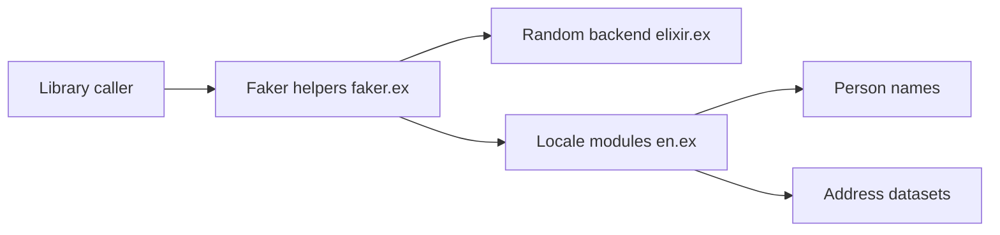

# elixirs/faker

> Pure Elixir library that generates fake data for tests.

## The problem
Writing tests with believable names, addresses or companies forces you to build datasets by hand.

## What it actually does
Faker provides modules per domain (address, person, company, phone, food, internet, finance, etc.) with datasets per language. A common module exposes the random-draw functions, with a configurable backend. The README is limited to installation and refers to the documentation for usage.

## How it is wired


## Trying it
```elixir
# dans mix.exs
{:faker, "~> 0.19.0-alpha.5", only: :test}
```
```bash
mix deps.get
# puis ajouter Faker.start() dans test/test_helper.exs
```

## Cost and gotchas
Free. Requirements: OTP 19 and Elixir 1.6 or later. The version shown is an alpha.

## What it is not
Not a generator of statistically realistic data for training models: it is test fixture data. The README mentions Blacksmith for templates.

## Alternatives
Blacksmith (named in the README) for building test templates.

## For you
Ignore: reserved for Elixir projects, of no interest for a Python or MLOps profile.
