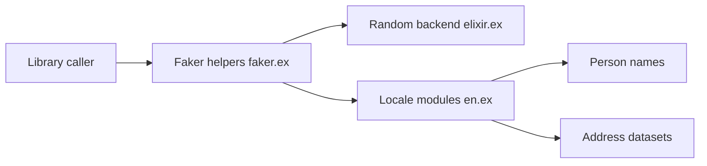

# elixirs/faker

> Bibliothèque Elixir pure qui génère de fausses données pour les tests.

## Le problème
Écrire des tests avec des noms, adresses ou entreprises crédibles oblige à fabriquer des jeux de données à la main.

## Ce que ça fait vraiment
Faker fournit des modules par domaine (adresse, personne, entreprise, téléphone, nourriture, internet, finance, etc.) avec des jeux de données par langue. Un module commun expose les fonctions de tirage aléatoire, avec un backend configurable. Le README se limite à l'installation et renvoie à la documentation pour l'usage.

## Comment c'est branché


## Essayer
```elixir
# dans mix.exs
{:faker, "~> 0.19.0-alpha.5", only: :test}
```
```bash
mix deps.get
# puis ajouter Faker.start() dans test/test_helper.exs
```

## Coût et pièges
Gratuit. Prérequis : OTP 19 et Elixir 1.6 ou plus. La version indiquée est une alpha.

## Ce que ce n'est pas
Pas un générateur de données statistiquement réalistes pour entraîner des modèles : c'est du jeu de test. Le README mentionne Blacksmith pour les gabarits.

## Alternatives
Blacksmith (nommé dans le README) pour construire des gabarits de test.

## Pour toi
Ignorer : réservé aux projets Elixir, sans intérêt pour un profil Python ou MLOps.

