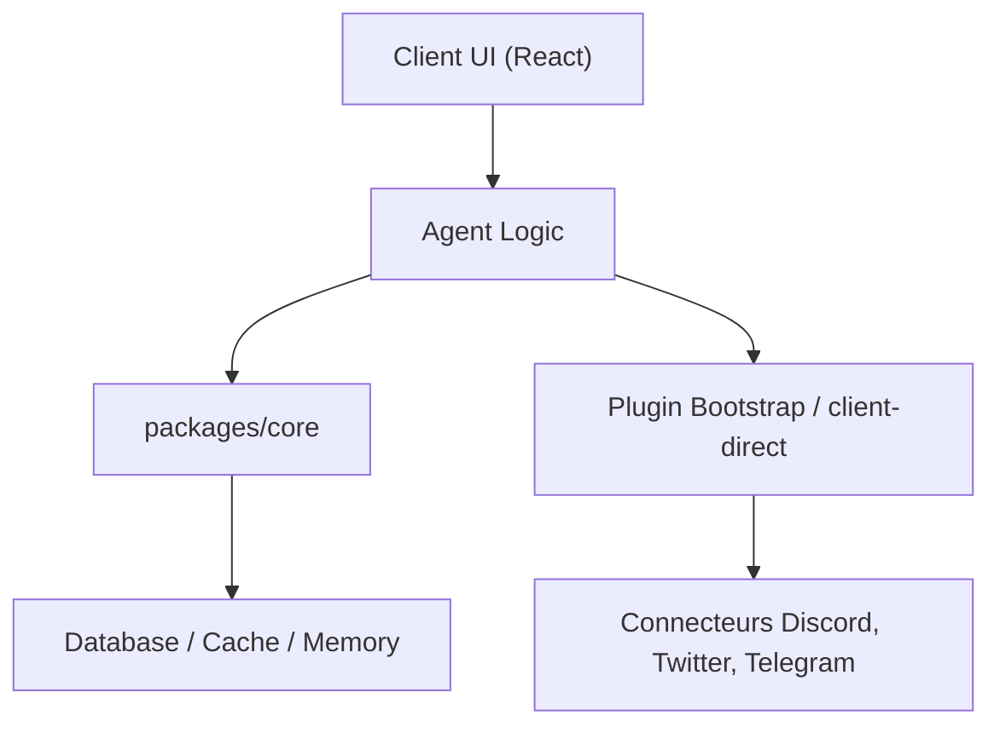

# elizaOS/eliza

> Open source TypeScript framework for autonomous AI agents, with runtime, application, CLI and plugins.

## The problem
Assembling a durable agent (memory, connectors, tools, models) by hand takes a lot of code repeated from one project to the next.

## What it actually does
A monorepo: the `@elizaos/core` runtime, an `@elizaos/agent` agent host, a web/desktop/mobile application and plugins (connectors, models, domains). Models can be local (Eliza-1 inference), direct from a provider or via Eliza Cloud, which is optional. Tool versions are pinned in `package.json`.

## How it is wired

The diagram provided describes an old state of the repository (`client/`, `agent/` folders).

## Trying it
```bash
git clone --filter=blob:none https://github.com/elizaos/eliza.git
cd eliza
bun install
bun run dev
```

## Cost and gotchas
Model provider keys are at your expense, except for local inference (model downloads, suitable hardware). The installation prepares submodules and patches: the first setup is heavy.

## What it is not
Not a simple package: it is a vast monorepo whose feature availability depends on plugins and permissions. Eliza Cloud is not required but is part of the stack.

## Alternatives
No alternative named in the README.

## For you
Worth watching: interesting for prototyping agents with ready-made connectors, but the surface is huge and the diagram provided is outdated, so evaluate it on a specific use case.
