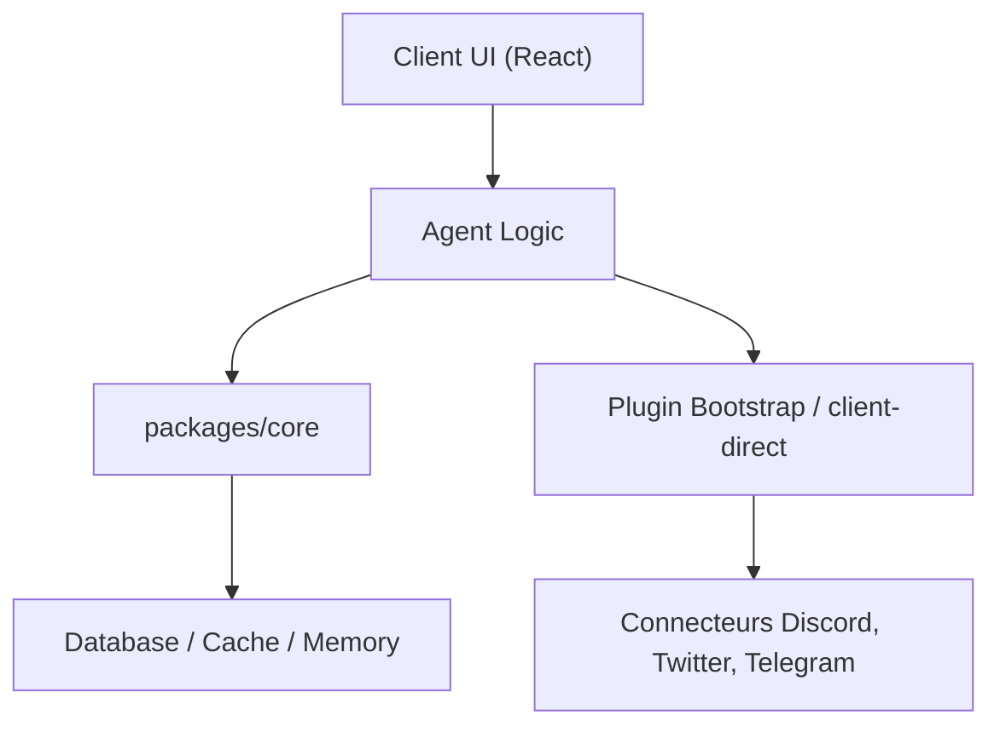

# elizaOS/eliza

> Framework TypeScript open source pour agents IA autonomes, avec runtime, application, CLI et plugins.

## Le problème
Assembler un agent durable (mémoire, connecteurs, outils, modèles) à la main demande beaucoup de code répété d'un projet à l'autre.

## Ce que ça fait vraiment
Un monorepo : le runtime `@elizaos/core`, un hôte d'agent `@elizaos/agent`, une application web/bureau/mobile et des plugins (connecteurs, modèles, domaines). Les modèles peuvent être locaux (inférence Eliza-1), directs chez un fournisseur ou via Eliza Cloud, optionnel. Les versions d'outils sont épinglées dans `package.json`.

## Comment c'est branché

Le diagramme fourni décrit un état ancien du dépôt (dossiers `client/`, `agent/`).

## Essayer
```bash
git clone --filter=blob:none https://github.com/elizaos/eliza.git
cd eliza
bun install
bun run dev
```

## Coût et pièges
Clés de fournisseurs de modèles à ta charge, sauf inférence locale (téléchargement de modèles, matériel adapté). L'installation prépare sous-modules et correctifs : première mise en route lourde.

## Ce que ce n'est pas
Pas un simple paquet : c'est un monorepo vaste dont la disponibilité des fonctions dépend des plugins et permissions. Eliza Cloud n'est pas requis mais fait partie de la pile.

## Alternatives
Aucune alternative nommée dans le README.

## Pour toi
À surveiller : intéressant pour prototyper des agents avec connecteurs prêts, mais la surface est énorme et le diagramme fourni est daté, donc à évaluer sur un cas précis.

