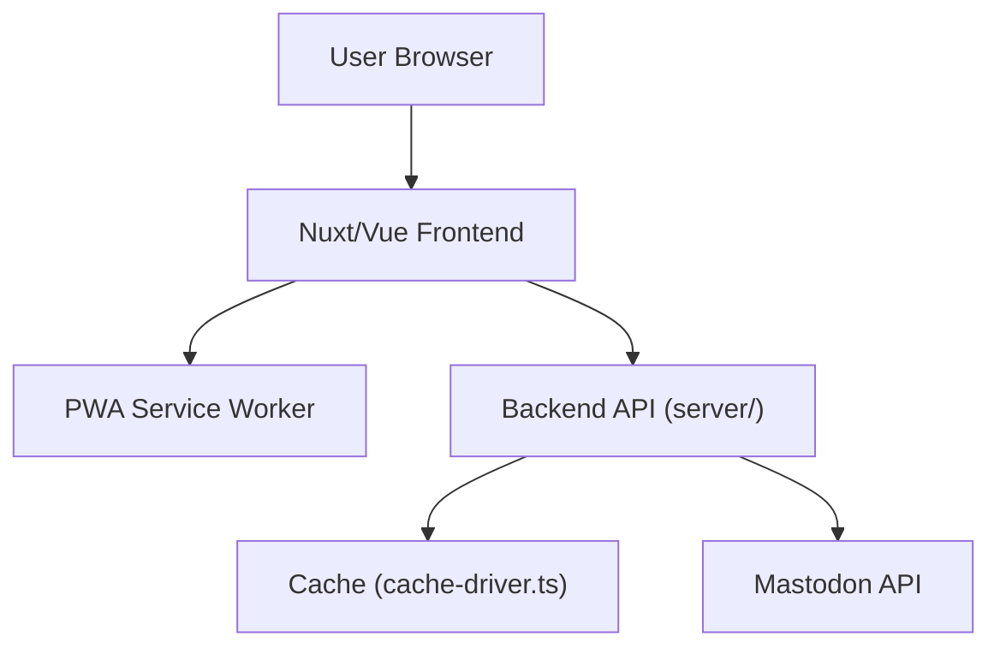

# elk-zone/elk

> Responsive Mastodon web client, in Nuxt and Vue, for fediverse users.

## The problem
The default Mastodon web interfaces are judged unpleasant by some users.

## What it actually does
Elk is a web application and PWA that connects to any compatible Mastodon server. A Nuxt backend handles login and OAuth, and `masto.js` talks to the Mastodon API. It also handles push notifications and sharing through the service worker.

## How it is wired


## Trying it
```bash
git clone https://github.com/elk-zone/elk.git
cd elk
pnpm i
pnpm run dev
# ou en conteneur : docker compose up --build -d
```

## Cost and gotchas
Free. Docker does not handle TLS: Elk only loads correctly over SSL/TLS, so a reverse proxy is needed. The data volume requires UID 911 permissions. 662 open issues. Community deployments are not maintained by the team.

## What it is not
It is not a Mastodon server: it is only a client. It does not replace an instance.

## Alternatives
- crab: lightweight fork of Elk, cited in the ecosystem.

## For you
Ignore: social network client, outside the data / AI / MLOps scope.
