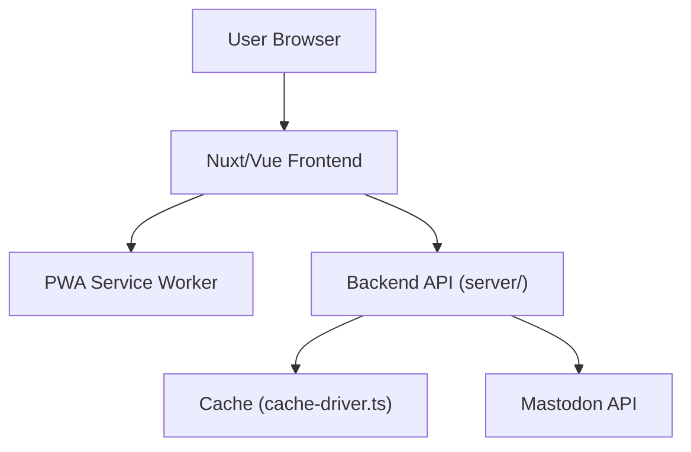

# elk-zone/elk

> Client web Mastodon réactif, en Nuxt et Vue, pour utilisateurs du fédiverse.

## Le problème
Les interfaces web Mastodon par défaut sont jugées peu agréables par certains utilisateurs.

## Ce que ça fait vraiment
Elk est une application web et PWA qui se connecte à n'importe quel serveur Mastodon compatible. Un backend Nuxt gère la connexion et OAuth, et `masto.js` parle à l'API Mastodon. Il gère aussi les notifications push et le partage via le service worker.

## Comment c'est branché


## Essayer
```bash
git clone https://github.com/elk-zone/elk.git
cd elk
pnpm i
pnpm run dev
# ou en conteneur : docker compose up --build -d
```

## Coût et pièges
Gratuit. Docker ne gère pas le TLS : Elk n'est chargé correctement qu'en SSL/TLS, donc il faut un proxy inverse. Le volume de données exige les droits UID 911. 662 issues ouvertes. Les déploiements communautaires ne sont pas maintenus par l'équipe.

## Ce que ce n'est pas
Ce n'est pas un serveur Mastodon : c'est seulement un client. Il ne remplace pas une instance.

## Alternatives
- crab : fork léger d'Elk, cité dans l'écosystème.

## Pour toi
À ignorer : client de réseau social, hors du périmètre data / IA / MLOps.

