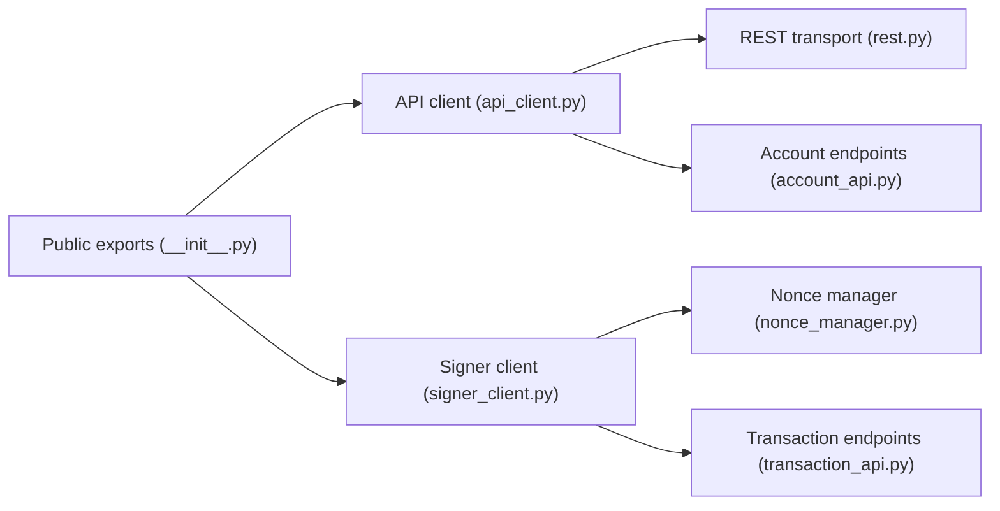

# elliottech/lighter-python

> Python SDK for the zkLighter perpetual contracts exchange, with REST, websocket and signing.

## The problem
Interacting with the exchange's API requires building requests and signing transactions yourself.

## What it actually does
Asynchronous client with typed classes per endpoint family (account, orders, blocks, bridge, referral, transactions), response models, a signer client with a nonce manager (native binaries) and a websocket client. Examples are provided for public reads, streams and orders.

## How it is wired


## Trying it
```bash
pip install git+https://github.com/elliottech/zklighter-perps-python.git
python -c "import lighter"
```

## Cost and gotchas
Free; real orders on an exchange, API key and signer to configure. Python 3.8+. The README's install URL points to another repository (`zklighter-perps-python`).

## What it is not
Not a trading strategy: only an API client. The README lists the endpoints without explaining them.

## Alternatives
No alternative named in the README.

## For you
Ignore: useful only for trading on this exchange, unrelated to data or MLOps.
