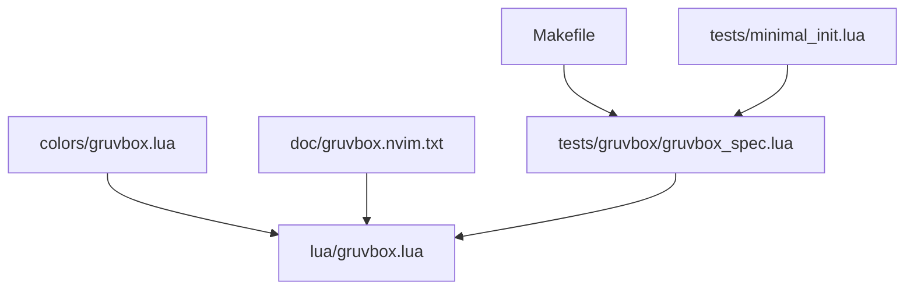

# ellisonleao/gruvbox.nvim

> Gruvbox theme in Lua for Neovim, with treesitter and semantic highlighting.

## The problem
The original gruvbox theme does not cover treesitter or Neovim's LSP semantic tokens.

## What it actually does
The `colorscheme` command loads `colors/gruvbox.lua`, which calls `lua/gruvbox.lua`: palette, options, highlight groups. Soft or hard contrast, override of the palette and of the groups. A Makefile runs tests.

## How it is wired


## Trying it
```lua
{ "ellisonleao/gruvbox.nvim", priority = 1000 , config = true, opts = ...}
require("gruvbox").setup()
vim.cmd.colorscheme("gruvbox")
```

## Cost and gotchas
Free. Neovim 0.8 or later. Call `setup()` before `colorscheme`; the README insists on this.

## What it is not
Not a classic Vim theme: it is Neovim with Lua.

## Alternatives
No alternative named in the README.

## For you
Ignore: a matter of editor taste, nothing at stake for work.
