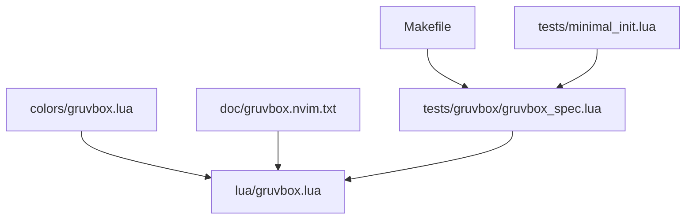

# ellisonleao/gruvbox.nvim

> Thème gruvbox en Lua pour Neovim, avec treesitter et surbrillance sémantique.

## Le problème
Le thème gruvbox d'origine ne couvre pas treesitter ni les jetons sémantiques LSP de Neovim.

## Ce que ça fait vraiment
La commande `colorscheme` charge `colors/gruvbox.lua`, qui appelle `lua/gruvbox.lua` : palette, options, groupes de surbrillance. Contraste doux ou fort, surcharge de la palette et des groupes. Un Makefile lance des tests.

## Comment c'est branché


## Essayer
```lua
{ "ellisonleao/gruvbox.nvim", priority = 1000 , config = true, opts = ...}
require("gruvbox").setup()
vim.cmd.colorscheme("gruvbox")
```

## Coût et pièges
Gratuit. Neovim 0.8 ou plus. Appeler `setup()` avant `colorscheme`, le README insiste.

## Ce que ce n'est pas
Pas un thème Vim classique : Neovim avec Lua.

## Alternatives
Aucune alternative nommée dans le README.

## Pour toi
Ignorer : question de goût d'éditeur, sans enjeu de travail.

