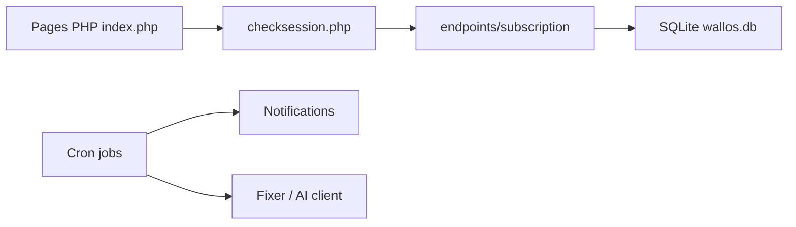

# ellite/Wallos

> Self-hosted web application for tracking subscriptions and recurring expenses, for individuals.

## The problem
Subscriptions pile up and due dates get lost in spreadsheets.

## What it actually does
PHP 8.3 application with a SQLite database: manages subscriptions, categories, multiple currencies (rates via the Fixer API), statistics, an iCal calendar and notifications (mail, Discord, Telegram, ntfy, webhooks...). Login by password, TOTP or OIDC. AI recommendations go through ChatGPT, Gemini or a local Ollama.

## How it is wired


## Trying it
```bash
docker run -d --name wallos -v /path/to/config/wallos/db:/var/www/html/db \
-v /path/to/config/wallos/logos:/var/www/html/images/uploads/logos \
-e TZ=Europe/Berlin -p 8282:80 --restart unless-stopped \
bellamy/wallos:latest
```

## Cost and gotchas
Free; a free Fixer key is needed for conversions and an LLM key for recommendations. Cron jobs are required outside Docker. GPL-3.0 license.

## What it is not
Not a full accounting tool: it tracks subscriptions. The demo resets every 2 hours.

## Alternatives
- No alternative named in the README.

## For you
Ignore: personal application unrelated to your work, unless you want to host it at home.
