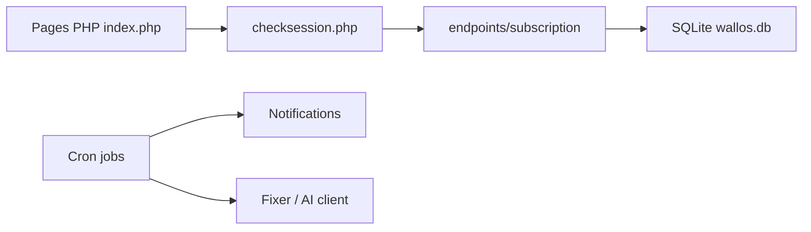

# ellite/Wallos

> Application web auto-hébergée de suivi d'abonnements et de dépenses récurrentes, pour particuliers.

## Le problème
Les abonnements s'accumulent et les échéances se perdent dans des tableurs.

## Ce que ça fait vraiment
Application PHP 8.3 avec base SQLite : gère abonnements, catégories, devises multiples (taux via l'API Fixer), statistiques, calendrier iCal et notifications (mail, Discord, Telegram, ntfy, webhooks…). Connexion par mot de passe, TOTP ou OIDC. Des recommandations IA passent par ChatGPT, Gemini ou Ollama local.

## Comment c'est branché


## Essayer
```bash
docker run -d --name wallos -v /path/to/config/wallos/db:/var/www/html/db \
-v /path/to/config/wallos/logos:/var/www/html/images/uploads/logos \
-e TZ=Europe/Berlin -p 8282:80 --restart unless-stopped \
bellamy/wallos:latest
```

## Coût et pièges
Gratuit ; une clé Fixer gratuite est nécessaire pour les conversions et une clé LLM pour les recommandations. Des tâches cron sont requises hors Docker. Licence GPL-3.0.

## Ce que ce n'est pas
Pas un outil de comptabilité complet : il suit des abonnements. La démo se réinitialise toutes les 2 heures.

## Alternatives
- Aucune alternative nommée dans le README.

## Pour toi
À ignorer : application personnelle sans lien avec ton métier, sauf envie de l'héberger chez toi.

