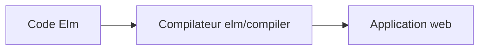

# elm/compiler

> Compiler for the Elm language, designed for reliable web applications.

## The problem
Nearly empty README: it describes no specific problem, only the slogan "a delightful language for reliable web applications".

## What it actually does
Not documented in the README: only four links (home page, online try-out, official guide, installation instructions) and a pointer to the Slack channel. The catalogue shows a repository active in 2026 (last push 2026-10-02).

## How it is wired

## Trying it
No command documented in the README; it points to the installation page of the official site.

## Cost and gotchas
Free. Installation and version details: see the site, not reproduced in the README.

## What it is not
Not a data/AI tool. No usage documentation here.

## Alternatives
None cited in the README.

## For you
Ignore: README too thin to judge, and a front-end language far from your data/AI/MLOps work.
