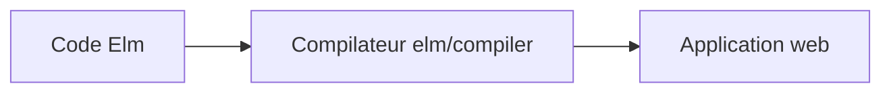

# elm/compiler

> Compilateur du langage Elm, pensé pour des applications web fiables.

## Le problème
README quasi vide : il ne décrit pas de problème précis, seulement le slogan « langage agréable pour applications web fiables ».

## Ce que ça fait vraiment
Non documenté dans le README : seuls quatre liens (accueil, essai en ligne, guide officiel, instructions d'installation) et un renvoi vers le canal Slack. Le catalogue donne un dépôt actif en 2026 (dernier push 2026-10-02).

## Comment c'est branché

## Essayer
Aucune commande documentée dans le README ; il renvoie à la page d'installation du site officiel.

## Coût et pièges
Gratuit. Détails d'installation et de versions : voir le site, non repris dans le README.

## Ce que ce n'est pas
Pas un outil data/IA. Pas de documentation d'usage ici.

## Alternatives
Aucune citée dans le README.

## Pour toi
Ignorer : README trop mince pour juger, et langage de front-end éloigné de ton travail data/IA/MLOps.

