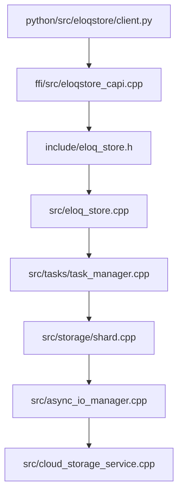

# eloqdata/eloqstore

> Two-tier C++ key-value engine (NVMe disk and S3 object storage) for write-heavy workloads.

## The problem
Keep memory-like latencies on large volumes without paying for RAM, with durability on object storage.

## What it actually does
Copy-on-write B-tree, non-leaf indexes in memory for one disk read per cold access, `io_uring` asynchronous I/O, zero-copy snapshots, instant branches "for AI/ML workloads". Python and Rust SDKs, plus a KV cache connector for vLLM (guide in `docs/vllm_kvcache_guide.md`). README figures (4x, 10x cheaper than Redis): not verified here.

## How it is wired


## Trying it
```bash
pip install eloqstore
# Python :
# client = Client(Options(table_name="demo", partition_id=0, num_threads=1)); client.put("hello", b"world")
bash scripts/install_dependency_ubuntu2404.sh
cmake .. -DCMAKE_BUILD_TYPE=Release && cmake --build . -j8
```

## Cost and gotchas
Linux 6.8+ (Ubuntu 24.04), S3-compatible backend, long compilation. Dual license BSL 2.0 or AGPL v3: read before commercial use.

## What it is not
Not a full database: the storage layer under the EloqKV, EloqDoc, EloqSQL products. 48 open issues.

## Alternatives
Redis: cited as a comparison reference, which the project says it can replace via EloqKV.

## For you
Watch: the vLLM KV cache connector may interest an inference MLOps engineer, but the BSL/AGPL license and kernel requirements call for a real evaluation.
