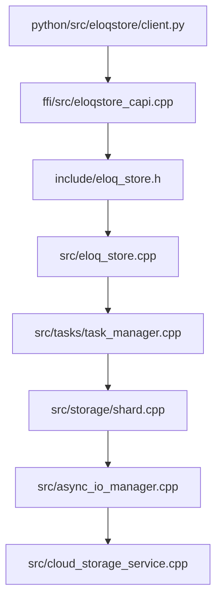

# eloqdata/eloqstore

> Moteur clé-valeur C++ à deux niveaux (disque NVMe et stockage objet S3) pour charges lourdes en écriture.

## Le problème
Garder des latences de type mémoire sur de gros volumes sans payer la RAM, avec durabilité sur stockage objet.

## Ce que ça fait vraiment
B-tree en copie sur écriture, index non-feuilles en mémoire pour une lecture disque par accès à froid, E/S asynchrones `io_uring`, instantanés sans copie, branches instantanées « pour charges IA/ML ». SDK Python et Rust, plus un connecteur de cache KV pour vLLM (guide dans `docs/vllm_kvcache_guide.md`). Chiffres du README (4x, 10x moins cher que Redis) : non vérifiés ici.

## Comment c'est branché


## Essayer
```bash
pip install eloqstore
# Python :
# client = Client(Options(table_name="demo", partition_id=0, num_threads=1)); client.put("hello", b"world")
bash scripts/install_dependency_ubuntu2404.sh
cmake .. -DCMAKE_BUILD_TYPE=Release && cmake --build . -j8
```

## Coût et pièges
Linux 6.8+ (Ubuntu 24.04), backend S3-compatible, compilation longue. Double licence BSL 2.0 ou AGPL v3 : à lire avant usage commercial.

## Ce que ce n'est pas
Pas une base de données complète : la couche de stockage sous les produits EloqKV, EloqDoc, EloqSQL. 48 issues ouvertes.

## Alternatives
Redis : cité comme référence de comparaison, que le projet dit pouvoir remplacer via EloqKV.

## Pour toi
Surveiller : le connecteur de cache KV vLLM peut intéresser un MLOps d'inférence, mais la licence BSL/AGPL et les exigences noyau demandent une vraie évaluation.

