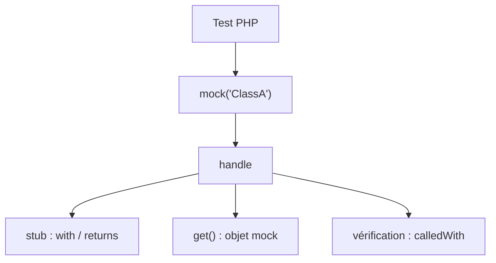

# eloquent/phony

> PHP test double library (mocks, stubs, spies), archived and no longer maintained.

## The problem
PHPUnit or Mockery mocks in the "expect, run, verify" style are hard to reuse and to debug.

## What it actually does
Creates object mocks, stubs and function spies, with verification after execution (calls, arguments, returns, exceptions, generators, order). Separate Composer packages exist for Kahlan, PHPUnit and Peridot; standalone use is possible.

## How it is wired


## Trying it
```bash
# paquet Composer selon le framework : eloquent/phony, eloquent/phony-phpunit,
# eloquent/phony-kahlan, eloquent/phony-peridot
```

## Cost and gotchas
The repo is archived and its README says it is no longer maintained; last push in 2023. No exact install command in the README, only package names.

## What it is not
Not an active tool nor a maintained substitute for PHPUnit; does not support recent PHP versions beyond 2023.

## Alternatives
Phake, Prophecy, Mockery, PHPUnit: cited in the README, which criticizes them for their verification style.

## For you
Ignore: archived, PHP, outside your domain.
