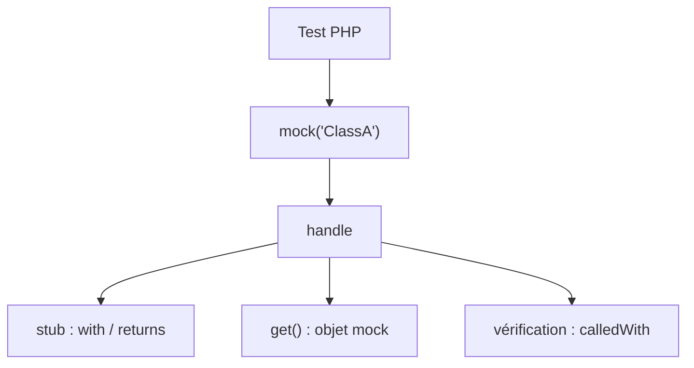

# eloquent/phony

> Bibliothèque PHP de doublures de test (mocks, stubs, espions), archivée et plus maintenue.

## Le problème
Les mocks PHPUnit ou Mockery de style « attendre, exécuter, vérifier » sont difficiles à réutiliser et à déboguer.

## Ce que ça fait vraiment
Crée des mocks d'objets, des stubs et des espions de fonctions, avec vérification après exécution (appels, arguments, retours, exceptions, générateurs, ordre). Des paquets Composer distincts existent pour Kahlan, PHPUnit et Peridot ; l'usage autonome est possible.

## Comment c'est branché


## Essayer
```bash
# paquet Composer selon le framework : eloquent/phony, eloquent/phony-phpunit,
# eloquent/phony-kahlan, eloquent/phony-peridot
```

## Coût et pièges
Le dépôt est archivé et son README annonce qu'il n'est plus maintenu ; dernier push en 2023. Pas de commande d'installation exacte dans le README, seulement les noms de paquets.

## Ce que ce n'est pas
Pas un outil actif ni un substitut maintenu à PHPUnit ; ne prend pas en charge les versions récentes de PHP au-delà de 2023.

## Alternatives
Phake, Prophecy, Mockery, PHPUnit : cités dans le README, ce dernier les critique pour leur style de vérification.

## Pour toi
À ignorer : archivé, PHP, hors de ton domaine.

