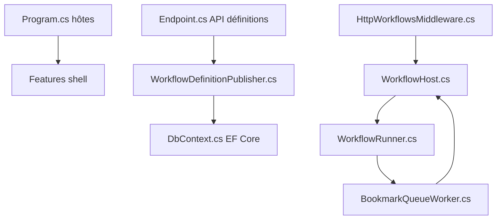

# elsa-workflows/elsa-core

> Workflow engine for .NET applications, defined in C#, JSON or a visual designer.

## The problem
Orchestrating long-running processes (validation, sending emails, scheduled tasks) in a .NET application without reinventing persistent state and resumption.

## What it actually does
Elsa runs short or long workflows in any .NET application. They are defined in C# code, in JSON or via a Blazor web designer. The runtime persists state and bookmarks, supports HTTP, scheduling and webhooks, and relies on EF Core, MongoDB or Dapper. Expressions in C#, JavaScript, Python and Liquid.

## How it is wired


## Trying it
```bash
docker pull elsaworkflows/elsa-server-and-studio-v3:latest
docker run -t -i -e ASPNETCORE_ENVIRONMENT='Development' -e HTTP_PORTS=8080 -e HTTP__BASEURL=http://localhost:13000 -p 13000:8080 elsaworkflows/elsa-server-and-studio-v3:latest
```
Interface at http://localhost:13000, credentials admin / password.

## Cost and gotchas
Free. The Docker image is a reference application, not intended for production; a secret JWT key must be injected for any real deployment. Elsa+ courses exist separately.

## What it is not
Not a no-code tool for non-developers: it is a .NET library. Announced limits: designer limited to Flowchart activities, no UI input validation, documentation a work in progress.

## Alternatives
No alternative named in the README.

## For you
Worth watching: relevant if your team writes .NET, of little use for a Python data/AI pipeline.
