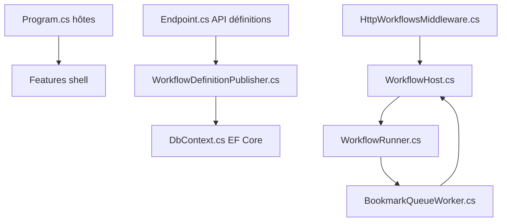

# elsa-workflows/elsa-core

> Moteur de workflows pour applications .NET, définis en C#, JSON ou designer visuel.

## Le problème
Orchestrer des processus longs (validation, envoi d'e-mails, tâches planifiées) dans une application .NET sans réinventer l'état persistant et la reprise.

## Ce que ça fait vraiment
Elsa exécute des workflows courts ou longs dans toute application .NET. Ils se définissent en code C#, en JSON ou via un designer web Blazor. Le runtime persiste état et signets, supporte HTTP, planification et webhooks, et s'appuie sur EF Core, MongoDB ou Dapper. Expressions en C#, JavaScript, Python et Liquid.

## Comment c'est branché


## Essayer
```bash
docker pull elsaworkflows/elsa-server-and-studio-v3:latest
docker run -t -i -e ASPNETCORE_ENVIRONMENT='Development' -e HTTP_PORTS=8080 -e HTTP__BASEURL=http://localhost:13000 -p 13000:8080 elsaworkflows/elsa-server-and-studio-v3:latest
```
Interface sur http://localhost:13000, identifiants admin / password.

## Coût et pièges
Gratuit. L'image Docker est une application de référence, non prévue pour la production ; il faut injecter une clé JWT secrète pour tout déploiement réel. Des cours Elsa+ existent à part.

## Ce que ce n'est pas
Pas un outil sans code pour non-développeurs : c'est une bibliothèque .NET. Limites annoncées : designer limité aux activités Flowchart, pas de validation des entrées UI, documentation en chantier.

## Alternatives
Aucune alternative nommée dans le README.

## Pour toi
À surveiller : pertinent si ton équipe écrit du .NET, peu utile pour un pipeline data/IA en Python.

