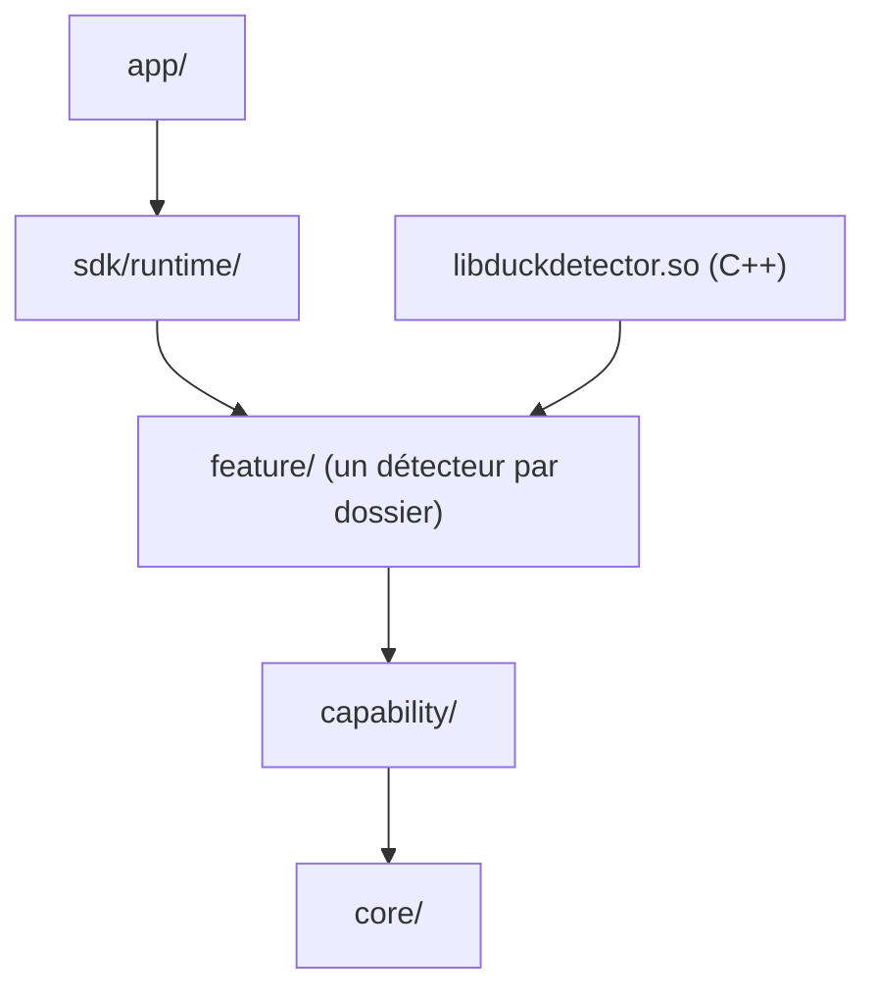

# eltavine/Duck-Detector-Refactoring

> Android diagnostic app that exposes device integrity signals, Momo-style.

## The problem
Some apps treat the user differently depending on the integrity of their device, without saying so clearly.

## What it actually does
Collects local evidence: bootloader state, root and SU, injection or hooking, mounts, system properties, KeyStore and TEE attestation, virtualization. Each detector gives a status (Danger, Warning, All Clear, Info). The same detectors are published as a UI-less AAR SDK. The results are heuristic, not proof.

## How it is wired


## Trying it
```bash
git submodule update --init --recursive
./gradlew :app:assembleDebug
./gradlew :sdk:aar:publish
```

## Cost and gotchas
Free, no root needed. Heavy build: Android SDK 37, NDK 30, JDK 17, CMake. Optional network access (TEE revocation, GitHub updates, possibly via gh-proxy.com).

## What it is not
Not a security verdict nor a bypass: the tool observes, it hides nothing. No stable release, only Nightly builds.

## Alternatives
The README cites Momo as a comparable tool.

## For you
Ignore: Android device diagnostics unrelated to data, AI or MLOps work.
